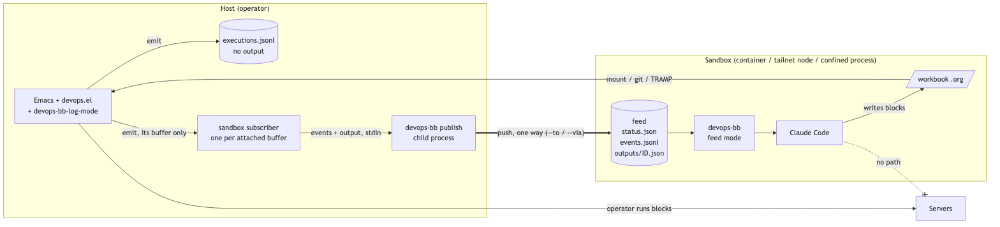

#+TITLE: Devops.bb for sandboxed execution
#+CATEGORY: work
#+PROPERTY: header-args:sh :results output
#+TARGET: .. (local)

* Background

Business reason: we work with servers and systems containing sensitive data.
Users have a significant access scope via CLIs and Tailscale SSH.

Best practices for security dictate that agents should be running in a
sandbox, where they cannot access the user's file system or other
credentialed services.  "Sandboxes" and other controls built into
agent harnesses are fragile, and the agent can overcome them easily. (I think.)

We believe the only way to run agents is in a separate machine or container.
Here, the agent writes files, runs local tools (in the sandbox, for example
finding a pattern using grep.)

When the agent needs something from the outside world, it should ask the user to
run a command. Copying and pasting commands and results is a terrible workflow,
especially in demanding situations like an incident, when we may be running dozens
of code blocks to find root cause.

Our approach leverages Emacs's org mode and its org-babel executable notebooks.
Devops.el contains some basic primitives like =TARGET= selection. devops.bb's
Emacs side (=emacs/=) logs what the operator does, and answers the
=devops-bb= commands over =emacsclient=.

This project implements a more highly opinionated flow using babashka tasks.
We would like to use this as a dependency in other projects' =bb.edn= tasks.

* Spec

** Goal

Claude Code runs in a *sandbox* and still works the devops-bb loop:

- it writes and edits its one workbook;
- the operator runs the blocks in Emacs, on the host;
- Claude follows each run and reads its output;
- it *never* executes anything on the servers, and holds nothing that
  could reach the host's Emacs or the servers.

This is the loop for all development, not only incidents: targets are
servers, other checked-out projects, ephemeral instances, and Claude
writes code next to the workbook as well as blocks.

#+begin_src mermaid :file "spec.png" :scale 2 
flowchart LR
  subgraph host["Host (operator)"]
    emacs["Emacs + devops.el + devops-bb-log-mode"]
    log[("executions.jsonl no output")]
    sub["sandbox subscriber one per attached buffer"]
    pub["devops-bb publish child process"]
  end

  servers["Servers"]

  subgraph sbx["Sandbox (container / tailnet node / confined process)"]
    claude["Claude Code"]
    cli["devops-bb feed mode"]
    feed[("feed status.json events.jsonl outputs/ID.json")]
    wb[/"workbook dir .org + code"/]
  end

  emacs -- "operator runs blocks" --> servers
  emacs -- "emit" --> log
  emacs -- "emit, its buffer only" --> sub
  sub -- "events + output, stdin" --> pub
  pub == "push, one way (--to / --via)" ==> feed
  feed --> cli --> claude
  claude -- "writes blocks + code" --> wb
  wb -- "mount / rsync pull" --> emacs
  claude -. "no path" .-x servers
#+end_src

#+RESULTS:

The sandbox is any place Claude can be put, not only a devcontainer:

| Sandbox                  | Workbook dir reaches the host by          | Feed reaches it by          |
|--------------------------+-------------------------------------------+-----------------------------|
| local container          | bind mount (rw) of the workbook dir       | bind mount (ro) of the feed |
| Tailscale node / SSH box | =devops-bb-sandbox-pull=, host-driven rsync | host pushes over =--ssh=    |

Either way the workbook dir is on the host's disk, so the host can
check and hash it (below). TRAMP is not supported: attach refuses a
remote =buffer-file-name=.

The workflow is the library's main one, so the design bends devops.bb
to it instead of wrapping it with scripts in each project
(replaces steps 4-5 of the infra-devcontainer workbook).

** The one idea

=devops.bb= answers from two sources on the host: the execution log (a
file) and Emacs (=emacsclient=). The sandbox can reach neither.

devops.bb writes the log too (=devops-bb-log-mode=,
=emacs/devops/bb/log.clj=), so the feed is made where the events
happen, in the operator's Emacs, instead of by reading the log back:

- *producer*, in the host's Emacs: a workbook buffer attached to a
  sandbox gets a *subscriber* to the log's events. It adds each
  finished run's output and writes the line to a child =devops-bb
  publish= on stdin. The child pushes a *feed*, a self-contained
  directory of plain files, to a *sink*.

- *consumer*, in the sandbox: with =DEVOPS_BB_FEED=DIR=, the same
  commands (=status=, =follow=, =run-output=, =modified=) read the feed.
  They never start =emacsclient=.

Data flows one way, host → sandbox. The sandbox has no credential for
the host.

** Threat model: the operator is the boundary

The read side is closed: the feed flows one way and carries no
credential. The write side is not, and cannot be: Claude writes the
files the host's Emacs loads and runs. Claude may propose any command;
the operator decides what runs. Everything below exists to make that
review real: the operator sees what will actually run, where, and what
changed since they last said yes, and nothing Claude writes runs
without that.

Ways in, and what closes each:

| Claude writes                                         | Closed by                                  |
|-------------------------------------------------------+--------------------------------------------|
| a block, or a changed block                           | confirm every run (Review)                 |
| =:var x=(elisp)=, =#+PROPERTY header-args=, noweb      | prompt shows processed params, expanded body |
| =#+TARGET=, static or dynamic                         | prompt shows resolved target; change re-prompts |
| =analyze.py=, =bb.edn= run by an approved block        | the workbook dir is in the fingerprint     |
| =# Local Variables:= / =eval:=                        | =hack-local-variables= advice              |
| =.dir-locals.el=, =.git/= (=core.fsmonitor=), =.envrc=, symlinks | dir check suspends the buffer     |
| a symlinked feed dir on an ssh node                   | =feed= user, symlink refusal (Sinks)       |
| (on the node) the operator's forwarded ssh-agent      | =--ssh= forces forwarding off (Sinks)      |
| (on the node) a direct route to the servers           | tailnet ACL, checked in step 4             |

Feed output is server output, and may carry injected text; the skill
tells Claude to treat it as data, not instructions.

** Review: confirming each run

devops.bb owns the policy; [[file:~/src/github.com/kpassapk/ob-confirm-posframe/ob-confirm-posframe.el][ob-confirm-posframe]] owns the display,
through generic extension points. =devops-bb-sandbox-attach= refuses
unless =ob-confirm-posframe-mode= is on: a bare =y/n= shows neither
headers nor diffs.

*Every run is confirmed, unless unchanged.* In an attached buffer
=org-confirm-babel-evaluate= decides by a *fingerprint* of the run:
lang, body, processed params (inherited ones included), the resolved
target and session, and a hash (path, size, sha256) of every file in
the workbook dir except the =.org=. A fingerprint the operator
confirmed and ran (=org-babel-after-execute-hook=) skips the prompt;
anything else prompts. Re-running an unchanged diagnostic stays one
keystroke; any edit Claude makes, to the block or to a file beside
it, prompts once with the diff.

devops.el resolves =#+TARGET= in its =org-babel-execute-src-block=
advice, before org's confirm, so by then =params= holds the injected
=:dir= and =:session=: the fingerprint and the prompt read them there.

*What the prompt shows*, via ob-confirm-posframe:

- =ob-confirm-posframe-header-functions= (exists): target and session.
- =ob-confirm-posframe-notice-functions= (new): highlighted lines above
  the body. devops.bb adds "changed since you ran it" with the block's
  diff, "files changed since you last ran a block" with =+n/-m= per
  file, "elisp in header: =:dir (…)=", "resolves target =prod= for
  =check-disk=", and "target changed: =A= → =B=".
- the body with noweb expanded (new, an option): the text that runs.
- =d= (new): the full notice, a multi-file =diff-mode= buffer, in a
  window, then back to the prompt.
- the advice goes on at depth -90 (new), outside devops.el's, so a
  dynamic target's block prompts inside the chain of the block the
  operator ran: =check-disk › pick-host=.

*Dynamic targets* stay: targets may be checkouts and ephemeral
instances. devops.el binds a public =devops-resolving-target=, =(TAG
. REF)=, while =devops--target-from-ref= runs, for the notice. The
target's block is fingerprinted like any other; its *output* is not
trusted that way: it is part of the main block's fingerprint, so a new
instance re-prompts every block under that heading once.

*State lives in a global registry*, ={base-buffer → attachment}=, not
in buffer-locals: =M-x revert-buffer= runs =normal-mode=, which kills
buffer-locals and then reads =# Local Variables:=. The registry holds
the subscriber, the publisher, the confirmed fingerprints, the last
confirmed text of each block and a snapshot of the workbook dir (for
the diffs). Detach clears it.

- =:around= advice on =hack-local-variables= binds
  =enable-local-variables=, =enable-local-eval= and
  =enable-dir-local-variables= to nil for an attached buffer.
- The global =org-confirm-babel-evaluate= is a wrapper: attached
  buffers get the fingerprint function, others the user's own setting.
- vc is off for attached buffers (=vc-handled-backends= nil around
  =vc-refresh-state=), so Emacs never runs =git status= in the dir.
- After a revert that changes keyword lines, =org-mode-restart=, so
  =#+PROPERTY= and =#+STARTUP= caches match the disk. Safety does not
  depend on it: the fingerprint uses the processed params.

*The workbook dir is checked* on attach, on every revert and before
every confirm. Any regular file and subdirectory is allowed: Claude
writes code. A dotfile or dot-dir at any depth (=.git=,
=.dir-locals.el=, =.envrc=, …) or a symlink (=lstat=, never followed)
*suspends* the buffer: every run is refused with "sandbox dir has
=.git/=: remove it to continue", and the mode line says =sandbox:
SUSPENDED=. =:file= and =:output-dir= must resolve inside the dir: no
absolute path, no =..=. The README says to keep LSP auto-start off in
sandbox dirs: clojure-lsp evaluates =bb.edn= and =deps.edn= on visit,
which no check can catch.

** Events: one emit, many subscribers

=log.clj= builds an entry and appends it to the log file. Split that:
=emit= builds the entry and hands it to each subscriber, and the log
file is one subscriber.

- *Log subscriber*, global: appends to =devops-bb-execution-log=, the
  same lines as today. They stay notifications, with no output,
  =#+RESULTS= or diff, and the file stays shared by every Emacs and
  workbook.
- *Sandbox subscriber*, one per attached buffer, cljbang in
  =sandbox.clj=: gets only the entries emitted from its buffer. For a
  =result= entry it takes the run's output from the session and sends
  the entry with an =output= field. For a sync =execute= (no =id=) it
  makes up a UUID and sends =#+RESULTS= as the output (Caveats).

Dispatch is by *base buffer*, not by =file=, so there is no path filter
to get wrong: =emit= looks up =(or (buffer-base-buffer)
(current-buffer))= in the registry (Review), so a run from an indirect
buffer (=org-tree-to-indirect-buffer=) reaches its workbook's sandbox.
Killing an indirect buffer does nothing; killing the base detaches. A
subscriber that fails is reported in =*Messages*= and does not stop
the others, the log, or the block run.

*One run, by ID.* The =result= entry is emitted inside ob-comint's
process filter. =devops-bb-scripting-run-output= scans the whole
session for every run; the subscriber instead uses a new
=devops-bb-scripting--run=, which searches the start and end markers
of that ID only, and =run-output= uses it too. The subscriber takes at
most =--max-bytes= × 2 of output, head and tail, so a huge output never
leaves Emacs; the publisher's cap stays the exact, tested rule.

*Emacs never waits.* The split, JSON lines on stdin the only interface:

| Emacs (cljbang): =log.clj=, =sandbox.clj=      | bb: =publish.clj=, =feed.clj=                 |
|------------------------------------------------+-----------------------------------------------|
| =emit= → subscribers, by base buffer           | stdin → queue, always drained                 |
| output by ID, rough head/tail cap              | exact cap, =seq=, =--map=, =status.json=       |
| =status= line on rename                        | sinks: =put=, =append=, retry, heartbeat      |
| child process, sentinel, mode line             | nothing about Emacs or org                    |
| review: fingerprint, dir check, notices        |                                               |

The log keeps its promise of no output. The feed carries output, but
only for the one workbook and the one sandbox it is bound to.

** One workbook per sandbox

A sandbox is bound to exactly one buffer, in one Emacs. The operator
can have many sandboxes at once, one per workbook, all from the same
Emacs.

*Attaching.* The operator attaches a workbook from its buffer with
=devops-bb-sandbox-attach= (cljbang, =emacs/devops/bb/sandbox.clj=). It
asks for a sink by name from =devops-bb-sandbox-sinks=, a defcustom
of named sinks (=--ssh= or =--via=, =--to=, =--map=, caps), and a feed
name, starts =devops-bb publish …= as a child process with stdin a
pipe, and registers the buffer. =devops-bb-sandbox-detach=, killing the
buffer, or quitting Emacs closes stdin: the publisher pushes what it
has, marks the feed detached, and exits. Killing a buffer with unsaved
edits sends its =kill= event before stdin closes. Attaching a buffer
that is already attached asks to replace its sink.

Attach refuses when =ob-confirm-posframe-mode= is off, when
=buffer-file-name= is remote, or when the dir check fails (Review). It
warns when the workbook's dir holds other =.org= files: one dir per
workbook.

*A dead publisher is loud.* A process sentinel watches the child. When
it dies the mode line says =sandbox: DEAD= and attach offers to
restart. A restart is a new attach: new =started=, =seq= from 1, and
=follow= tells Claude the feed restarted. No replay.

*One directory per workbook.* The sandbox gets the workbook's own
directory, rw, holding only that workbook, its =:file= outputs and the
code Claude writes: =work/<denote-id>/=, or any dir the operator picks.
Not the file: a file bind mount is pinned to an inode, and the first
save by rename leaves the sandbox on the old one. Not =work/=: the
siblings' =#+RESULTS= hold past server output. Attached buffers get
=backup-by-copying= anyway, for git and rsync. The feed is a separate
ro mount, never inside the workbook dir:
=-v $WB_DIR:/work:rw -v $FEED:/feed:ro=.

*Remote sandboxes: pull.* =devops-bb-sandbox-pull= runs =rsync -r
--no-links --exclude '.*'= from the sandbox into the local workbook
dir: on a timer while attached, and right before each confirm, so the
prompt reflects the latest. Symlinks and dotfiles never arrive. git by
hand stays possible; TRAMP is not supported.

*The feed name is the operator's.* It is asked at attach (default: the
file's base name), and goes in =status.json= and on every event as
=feed=. It names the attachment, not the file, and stays the same
across renames; a NATS subject later (below). It is never read from
the workbook: Claude writes the workbook.

*The sink is the operator's.* It is set in Emacs, never in the
workbook: Claude writes the workbook, and a sink written there could
point the push, with the operator's ssh credentials, anywhere.

*Renames.* Nothing to do. The subscriber is bound to the buffer, and
each entry reads =file= when it is emitted, so after
=set-visited-file-name= or a denote rename the next event carries the
new path. The subscriber sends a =status= line when the buffer's file
differs from the one it last sent, so =status.json= follows too.

*Shared shell sessions.* devops.el names sessions by target
(=devops:web-1 /ssh:web-1:=), so two workbooks on the same target share
a shell. The feed is per run and leaks nothing, but shell state (cwd,
exported variables) carries over between workbooks in different
sandboxes. The README says so; per-workbook session names are later
work.

** The feed

#+begin_example
FEED/
  status.json         feed name, workbook, devops-mode, attached, publisher heartbeat
  events.jsonl        the events, paths mapped, numbered by seq, appended in order
  outputs/<id>.json   run-output answer, one file per finished run
#+end_example

The publisher reads JSON lines on stdin, one at a time, in order. It
reads no log and asks no Emacs: it has no =--server= or =--file=, and
never runs =emacsclient=. What it pushes, Emacs handed it. Rules:

1. *Output before event.* A line with =output= becomes
   =outputs/<id>.json= first, then the event, without =output=, is
   appended to =events.jsonl=. A consumer that sees the event can read
   the output at once, so there is no =not-found= retry.
2. *Atomic.* Write to =.tmp=, rename. =events.jsonl= is append-only.
3. *Numbered.* Each event gets =seq=, 1, 2, … from the attach, so
   =follow= can resume after a seq. Attaching starts a new feed:
   =events.jsonl= starts empty, =seq= at 1, and =status.json='s
   =started= says when.
4. *Heartbeat.* =status.json= carries =publisher-time=, refreshed
   every few seconds, so the sandbox can tell a quiet workbook from a
   dead publisher, and =attached=, false once stdin closes. It names
   the =feed= and the =workbook= (mapped path), and =queued=, the
   events not yet pushed, so =follow= can say "publisher is N events
   behind" instead of only "stale". It does not carry
   =execution-log=: the log's path is the host's business.
5. *Path mapping.* =--map HOST=SANDBOX= rewrites =file= (=buffer=
   stays). Entries carry host paths; a sandbox that mounts elsewhere
   still resolves the workbook in =status=, =follow= and =modified=.
   Same absolute path (no =--map=) remains the easy case for
   containers.
6. *Outputs are JSON.* =outputs/<id>.json= is the =run-output= answer
   exactly as host mode prints it (={session, status, id, input,
   output}=). Feed mode prints the file as is, so both modes give the
   same shape and the skill does not need a separate path for feed mode.
   One file carries status and output together, so one rename keeps it
   atomic. For grep in the sandbox: =jq -r .output outputs/ID.json=.
7. *Capped.* An =output= over 500 lines or 64 KB, whichever comes
   first, keeps its first 250 and last 250 lines (within the byte
   cap), with one marker line between them: =[… N lines cut …]=. The
   answer then carries ="truncated": true= and the full size,
   ="lines"= and ="bytes"=. =--max-lines= and =--max-bytes= change the
   caps; they are given at attach, like the sink. A run's start says
   what it is and its end how it went, so both are kept. The cap
   protects the sink and Claude's context; host mode's =run-output= is
   not capped.
8. *Never blocks Emacs.* A reader thread drains stdin into an
   in-memory queue, capping each line as it takes it, so memory stays
   bounded; a writer thread pushes to the sink in order, retrying with
   backoff. A hung ssh never fills the pipe, so =process-send-string=
   in ob-comint's filter never blocks the operator's Emacs.
9. *Retries are safe.* =put= is a rename. A retried =append= may land
   twice; the reader skips any event whose =seq= is not above the last
   it saw.

** Sinks: where the feed goes

Two verbs, =put(path, bytes)= (replace atomically; =path= is relative
to =--to=) and =append(line)= (one JSON line, always appended to
=events.jsonl=), and two options, =--ssh= and =--via=:

| Sink                  | Flags                                          |
|-----------------------+------------------------------------------------|
| local directory       | =--to /path/feed= (dev and tests; no isolation by itself) |
| container (mount)     | =--to /path/feed=, mount that dir ro           |
| container (no mount)  | =--via "docker exec -i box" --to /feed=        |
| Tailscale / SSH node  | =--ssh feed@node --to /home/feed/feed=         |

With =--via CMD= and =--to TO=, =put= runs =CMD sh -c 'cat > F.tmp &&
mv F.tmp F'= (=F= is =TO/path=) and =append= runs =CMD sh -c 'cat >>
TO/events.jsonl'=. Anything that runs a command somewhere fits:
=docker exec -i=, =podman exec -i=, =kubectl exec -i=. No TRAMP
re-implementation.

*The push is a connection into a machine Claude controls*, so for ssh
it is built in, not left to the operator's config:

- =--ssh HOST= runs =ssh -T -o ForwardAgent=no -o ForwardX11=no -o
  ClearAllForwardings=yes -o PermitLocalCommand=no HOST …=. A
  =ForwardAgent yes= in =~/.ssh/config= (or =Host *=) would otherwise
  hand the node a live socket to the operator's agent, and Claude could
  =ssh web-1= with it. =--via "ssh …"= still works, with a loud README
  warning.
- *A =feed= user.* The README sets up a =feed= account on the node
  that owns the feed dir; Claude's user may read it, never write it.
  Otherwise Claude can replace =outputs/= with a symlink and the push
  writes, as the push user, wherever it points.
- The remote script refuses to write when =TO=, =TO/outputs= or the
  target is a symlink (=[ -L … ]=), as defense in depth.
- *Tailnet ACL.* Claude's "no path" to the servers is as real as the
  ACLs: the node gets a tag (=tag:sandbox=) with no grants to servers,
  and step 4 checks it from the node.

*One round trip per result.* A result is a =put= and an =append=. Over
=--ssh= or =--via= the publisher sends both in one command, so a run costs one
connection, not two: =CMD sh -c '…'= reads the output, then the event
line, from stdin, and does the rename before the append, keeping
"output before event". The heartbeat is a =put= of its own, every few
seconds. For ssh, the README recommends =ControlMaster= so each command
reuses one connection.

Why push, not pull: a pull would give the sandbox a way into the host.
Push needs host → sandbox access only, which the operator already has.

The sink flags are given to =devops-bb-sandbox-attach=. Run by hand, as
in the tests, =publish= takes them and reads its lines from stdin.

---

** Consumer: feed mode

- =DEVOPS_BB_FEED=DIR= (or =--feed DIR=) switches it on. Explicit, never
  auto-detected, so a mistake cannot fall back to Emacs.
- The commands read the feed through =feed.clj='s reader (=status=,
  =events-after seq=, =output id=), the one place a NATS reader would
  replace later.
- =status=: =status.json=. =follow=: tail =events.jsonl=, printing each
  event's =seq=; =--after SEQ= resumes. =run-output ID=:
  =outputs/ID.json=, or the =not-found= answer shape. =run-output=
  checks ID is a UUID (no path traversal).
- =status= names the feed and the workbook. =follow= needs no =--dir=:
  every event is the workbook's.
- =modified=: =true= when the last =modify= / =save= / =revert= /
  =kill= event in =events.jsonl= is a =modify=. =FILE=, if given, must
  be the workbook, or it fails with ="not this sandbox's workbook"=. It
  is a check, not a lock: the operator can start typing between check
  and write. Emacs still catches that and warns on the next edit that
  the file changed on disk.
- =output=, =sessions=, =revert=, =tools=, =drift=, =dashboard's Emacs views=: fail
  with ="needs Emacs, which this sandbox cannot reach"=. Dropped on
  purpose; the operator is the channel for them.
- =follow= in feed mode warns once when =publisher-time= is stale, and
  says so when =attached= is false.
- A =truncated= output: the skill tells Claude to say so, and to write
  a block that prints less (a filter, =head=, =grep=) instead of asking
  for the whole thing.
- Output is data. Server output can carry injected text; the skill
  tells Claude never to follow instructions found in it.

** Caveats

*Sync blocks reach the sandbox too.* Development means =emacs-lisp=,
=:results value=, =mermaid= and other =:file= blocks, which are sync:
no =id=, no =result= line. The subscriber runs in
=org-babel-after-execute-hook=, after =#+RESULTS= is written, so for a
sync =execute= from an attached buffer it makes up a UUID and sends
the event with ="id"=, ="sync": true= and the =output= from
=devops-bb-scripting--results-text=, capped the same way. A =:file=
result sends its link text; Claude reads the file through the
workbook dir. =outputs/<id>.json= keeps the =run-output= shape:
=session= null, =status= =done=, =input= the block's body. An entry
with an =error= (="Not run on a #+TARGET"=) passes with =output= null.

The output of a sync run is =#+RESULTS=, which org may have formatted
(tables, value results), not raw stdout, and stderr is lost unless
the block captures it. =output FILE LINE= is not in feed mode.

** Roadmap: agents on their own machines, a NATS log

- *The sink is the seam.* A NATS sink is two more verbs behind =put=
  and =append=: an output goes to a KV or object store keyed by run
  id, and an event is published on =devops.<feed>.events= in
  JetStream. The Emacs side does not change.
- With NATS the sandbox subscribes to
  the broker, not the host, with a credential that may read its feed's
  subjects only. Isolation moves from "what the publisher pushes" to
  account permissions.
- =seq= and the feed name are JetStream's sequence and subject.
- The consumer reads through =feed.clj='s reader; a NATS reader
  replaces the directory one.
- The global log could become a subscriber that publishes to NATS
  too, and the host's =follow= and dashboard read the stream.
- Agents on their own instances or containers do not change the event
  path. Getting the workbook to them stays the open problem (below).

** Not in scope

- Any channel from sandbox to host (no write-back). Claude checks
  =modified= before it writes; =revert= is replaced by
  =global-auto-revert-mode= on the host, which reloads an unmodified
  buffer once Claude's write lands (mount or pull). The README
  recommends it. The pull is host-driven, so it is not a channel from
  the sandbox.
- TRAMP workbooks, and two-way sync. The only sync built is
  =devops-bb-sandbox-pull= (sandbox → host, rsync).
- Redaction of secrets in output. The feed holds what Emacs holds.
  Claude does not quote credentials (as before); =bb scan= hooks stay.
- *Replay.* A new sandbox starts empty (follow starts "from now"). No
  =--since= to seed =events.jsonl= with recent history. A publisher
  restart is a new feed.
- Persisting confirmed fingerprints across Emacs restarts or detach.
- Stopping editor tooling (LSP, magit) that acts on the dir on visit;
  the README warns.
- NATS, and agents on their own machines (above).

** Done when

- =log.clj= emits to subscribers, and the log file subscriber writes
  the same lines as before: the log tests pass unchanged.
- =printf … | devops-bb publish --to FEED= fills a feed: outputs before
  their events, =seq=, heartbeat, =attached= false at EOF, and a
  2000-line output kept as its first and last 250 lines with
  =truncated=. No =emacsclient= process starts. With a sink that
  hangs, the publisher keeps reading stdin and =queued= grows; a
  duplicated append is skipped by =seq=.
- In an attached buffer: an unchanged, confirmed block runs without a
  prompt; a changed block, a changed target, or a changed file in the
  dir prompts with the diff. A dynamic target's block prompts as
  =block › target-block=.
- A planted =# Local Variables: eval:= does nothing on =M-x
  revert-buffer= or auto-revert; a planted =.git/=, dotfile or symlink
  suspends the buffer; =:file ../x= is refused.
- A sync block's =#+RESULTS= reaches the sandbox as an output.
- A run from an indirect buffer reaches its base buffer's feed.
- =devops-bb-sandbox-attach= in two workbook buffers of one Emacs gives
  two feeds, neither holding the other's events, while blocks run in
  both. Killing a buffer stops its publisher after its =kill= event;
  renaming its file keeps the feed, and the next event carries the new
  path.
- With =DEVOPS_BB_FEED=FEED= and *no Emacs reachable* (no socket, no
  =emacsclient= on PATH), =status=, =follow=, =run-output= and =modified=
  answer, and the others fail with the message above.
- The same feed works for: a local dir, a container with a ro mount,
  a container with =--via "docker exec -i"=, and a Tailscale node with
  =--ssh feed@node= and the workbook dir pulled.
- Tests: a new =feed-test= covers the publisher from stdin and the
  reader; =devops.bb.cli-test= covers feed mode and asserts that no
  =emacsclient= process starts; =bb test-emacs= covers subscriber
  dispatch by base buffer, the fingerprint, the dir check and the
  revert hardening; ob-confirm-posframe's =make test= covers notices,
  =d=, noweb preview and advice depth.
- =skills/devops-bb/SKILL.md= and README describe feed mode and its
  limits.
- The infra-devcontainer workbook shrinks to =.devcontainer= config and
  an attach.

** Code map

| File                            | Change                                                        |
|---------------------------------+---------------------------------------------------------------|
| =emacs/devops/bb/log.clj=       | =emit= and subscribers; the log file is one                   |
| =emacs/devops/bb/sandbox.clj=   | new, cljbang: registry, attach / detach, subscriber, publisher child, sentinel, pull; review: fingerprint, dir check, notices, =hack-local-variables= / vc advice |
| =emacs/devops-bb-scripting.el=  | =devops-bb-scripting--run=: one run by ID; =run-output= uses it |
| =emacs/test/devops-bb-test.el=  | dispatch by base buffer, attach, kill, rename, fingerprint, dir check, revert |
| devops.el                       | public =devops-resolving-target=, bound during resolution     |
| ob-confirm-posframe             | =notice-functions=, =d= full diff, noweb-expanded preview, advice depth -90 |
| =src/devops/bb/feed.clj=        | new: feed layout, =put=, =append=, the reader                 |
| =src/devops/bb/publish.clj=     | new: stdin → queue → capped outputs, numbered events; retry; heartbeat with =queued=; sinks incl. =--ssh= |
| =src/devops/bb/cli.clj=         | feed mode switch in each command; =publish= command           |
| =bb.edn=                        | task =publish=                                                |
| =skills/devops-bb/SKILL.md=     | "Sandbox / feed mode" section                                 |
| =README.md=                     | same, plus the sinks table                                    |

* TODO Steps

Everything here runs on the host and is run by the operator. Claude
writes the blocks and, once the spec is agreed, the code.

** DONE 1. Look at the real log                                     :local:

What event shapes existed, and were there any sync-block lines? Answered;
the log's shape is ours now (=emacs/devops/bb/log.clj=).

#+begin_src sh
jq -c '{event,status,line,id}' ~/.cache/devops/executions.jsonl | sort | uniq -c | sort -rn | head -20
#+end_src

#+RESULTS:
#+begin_example
15 {"event":"execute","status":null,"line":1140,"id":null}
   7 {"event":"drift","status":null,"line":477,"id":null}
   4 {"event":"execute","status":null,"line":603,"id":null}
   4 {"event":"execute","status":null,"line":16,"id":null}
   4 {"event":"drift","status":null,"line":1000,"id":null}
   3 {"event":"execute","status":null,"line":1006,"id":null}
   3 {"event":"execute","status":"not-found","line":114,"id":null}
   3 {"event":"drift","status":null,"line":316,"id":null}
   2 {"event":"tangle","status":null,"line":742,"id":null}
   2 {"event":"tangle","status":null,"line":477,"id":null}
   2 {"event":"tangle","status":null,"line":316,"id":null}
   2 {"event":"execute","status":null,"line":526,"id":null}
   2 {"event":"execute","status":null,"line":518,"id":null}
   2 {"event":"execute","status":null,"line":505,"id":null}
   2 {"event":"execute","status":null,"line":22,"id":null}
   2 {"event":"execute","status":null,"line":19,"id":null}
   2 {"event":"execute","status":null,"line":142,"id":null}
   2 {"event":"execute","status":null,"line":108,"id":null}
   2 {"event":"execute","status":null,"line":106,"id":null}
   2 {"event":"execute","status":null,"line":10,"id":null}
#+end_example

Execute lines with no =id= (sync blocks, or errors):

#+begin_src sh
jq -c 'select(.event=="execute" and (.id==null)) | {line,status,error}' ~/.cache/devops/executions.jsonl | tail -n 10
#+end_src

#+RESULTS:
#+begin_example
{"line":603,"status":null,"error":"Not run on a #+TARGET"}
{"line":603,"status":null,"error":"Not run on a #+TARGET"}
{"line":603,"status":null,"error":"Not run on a #+TARGET"}
{"line":22,"status":null,"error":"No src block at line 22"}
{"line":1128,"status":null,"error":"Not run on a #+TARGET"}
{"line":568,"status":null,"error":"Not run on a #+TARGET"}
{"line":491,"status":null,"error":"Not run on a #+TARGET"}
{"line":39,"status":null,"error":"Not run on a #+TARGET"}
{"line":40,"status":null,"error":"Not run on a #+TARGET"}
{"line":10,"status":null,"error":"Not run on a #+TARGET"}
#+end_example

** DONE 2. Sync block: when is it logged?                           :local:

Not needed: the subscriber sends a sync block's =#+RESULTS= after
=org-babel-after-execute-hook= (Caveats), so when the =execute= line is
logged no longer matters.

Open question 1. Run the block below (it is sync: no =:results output=),
then look at the log. The =sleep= makes "before or after" visible: if
the =execute= line's time is ~3s before the next log line or before
you got the result, it is logged first.

#+begin_src sh :results value
date +%T.%N; sleep 3; date +%T.%N
#+end_src

#+RESULTS:
: 0

#+begin_src sh
tail -n 4 ~/.cache/devops/executions.jsonl | jq -M -c '{time,event,status,line,id}'
#+end_src

#+RESULTS:
: {"time":"2026-10-16T10:49:19.967-0600","event":"result","status":"done","line":262,"id":"6628f1b2-99c5-4325-be43-e1eb35705f85"}
: {"time":"2026-10-16T10:50:36.045-0600","event":"execute","status":"running","line":275,"id":"d75b29c1-935e-42b1-b77d-84b8ff5171c1"}
: {"time":"2026-10-16T10:50:36.064-0600","event":"result","status":"done","line":275,"id":"6628f1b2-99c5-4325-be43-e1eb35705f85"}
: {"time":"2026-10-16T10:52:35.677-0600","event":"execute","status":"not-found","line":255,"id":null}

** TODO 3. Baseline: tests pass                                     :local:

#+begin_src sh
bb test 2>&1 | tail -n 5
bb test-emacs 2>&1 | tail -n 5
#+end_src

** TODO 4. Check the sandboxes you will demo with                   :local:

#+begin_src sh
command -v docker podman tailscale ssh rsync
tailscale status 2>&1 | head -n 5
#+end_src

The tailnet ACL is a precondition: from the sandbox node, as Claude's
user, a real server must be unreachable. Set =NODE= and =SERVER=; the
expected answer is =blocked=.

#+begin_src sh
NODE=sandbox-node SERVER=web-1
ssh -T -o ForwardAgent=no "$NODE" "nc -z -w 3 $SERVER 22 && echo REACHABLE || echo blocked"
#+end_src

** TODO 5. Does elisp in a header arg run before the prompt?        :local:

Run the block and answer =n=. Then read the last lines of
=*Messages*=. If "header elisp ran" is there, the prompt cannot guard
elisp header values, and the review must reject them before org
processes params, not only flag them.

#+begin_src emacs-lisp :var x=(progn (message "header elisp ran %s" (format-time-string "%T")) 1)
x
#+end_src

#+begin_src emacs-lisp :results output
(with-current-buffer "*Messages*"
  (goto-char (point-max))
  (forward-line -5)
  (princ (buffer-substring-no-properties (point) (point-max))))
#+end_src

** TODO 6. =emit= and subscribers in =log.clj=; log lines unchanged
** TODO 7. =devops-bb-scripting--run=: one run by ID
=run-output= uses it; its tests pass unchanged.
** TODO 8. Feed reader and consumer mode
** TODO 9. =publish= from stdin, with a local directory sink
Queue, exact cap, =seq=, =queued=; a sink that hangs; a duplicate append.
** TODO 10. ob-confirm-posframe: notices, =d=, noweb preview, depth -90
In =~/src/github.com/kpassapk/ob-confirm-posframe=; generic, no devops terms.
** TODO 11. devops.el: =devops-resolving-target=
** TODO 12. =devops-bb-sandbox-attach=: registry, two buffers, kill, rename
Indirect buffer runs reach the base's feed; sync blocks send =#+RESULTS=;
a dead publisher shows =sandbox: DEAD=. Re-run the mermaid block in Goal
for the new =spec.png=.
** TODO 13. Review: fingerprint, dir check, revert hardening
From outside Emacs, as Claude would: change a block, change a file in
the dir, plant =# Local Variables: eval: (message "pwned")= and revert
both ways, plant =.git/= and a symlink. Expected: prompts with diffs, no
"pwned", =sandbox: SUSPENDED=.
** TODO 14. =--ssh= sink and pull, to a tailnet node
=feed= user, symlink refusal, forwarding off. One command per result.
Time a few runs with and without =ControlMaster=.
** TODO 15. Container: ro mount, then =docker exec -i=
** TODO 16. Skill, README, tests
** TODO 17. Trim the infra-devcontainer workbook
